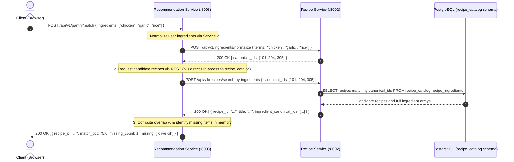
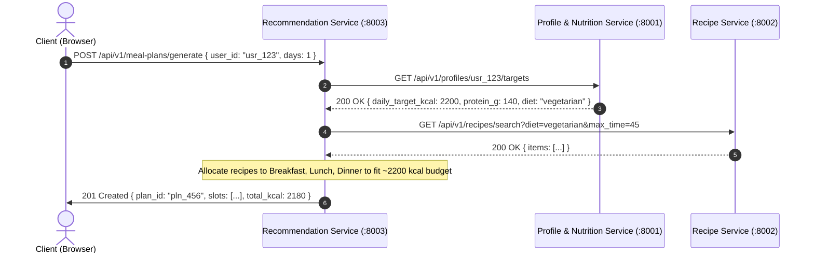

# NutriPod — System Architecture Document

| Metadata | Details |
| :--- | :--- |
| **Document Version** | 1.0.0 |
| **Status** | Approved Architectural Blueprint (Pre-Implementation) |
| **Author** | Senior Software Architect / NutriPod Technical Planning |
| **Runtime Target** | Podman / Docker Engine with Compose Orchestration |

---

## 1. Architectural Overview & Design Principles

NutriPod adopts a **practical, decoupled microservices architecture** composed of three independently maintainable Python/FastAPI backend services, a PostgreSQL relational datastore with strict schema boundaries, and a single-page React frontend.

```
+----------------------------------------------------------------------------------------------------+
|                                      CLIENT BROWSER (React + Vite)                                 |
|                                        http://localhost:5173                                       |
+----------------------------------------------------------------------------------------------------+
                                                   │
                                                   │ Reverse Proxy / Container Gateway
                                                   ▼
+----------------------------------------------------------------------------------------------------+
|                                      INTERNAL CONTAINER NETWORK                                    |
|                                            (foodflow-net)                                          |
|                                                                                                    |
|    ┌───────────────────────────┬───────────────────────────┬───────────────────────────┐           |
|    │ :8001                     │ :8002                     │ :8003                     │           |
|    ▼                           ▼                           ▼                           ▼           |
| +─────────────────────────+ +─────────────────────────+ +─────────────────────────+               |
| |   Member 1: Service A   | |   Member 2: Service B   | |   Member 3: Service C   |               |
| |  Profile & Nutrition    | |   Recipe & Ingredient   | |  Recommendation & Meal  |               |
| |         Service         | |         Service         | |     Planner Service     |               |
| +─────────────────────────+ +─────────────────────────+ +─────────────────────────+               |
|    │                           │                           │                                       |
|    │ REST / JSON               │ REST / JSON               │ REST / JSON                           |
|    │                           │                           │                                       |
|    └───────────────────────────┼───────────────────────────┘                                       |
|                                │                                                                   |
|                                ▼                                                                   |
|             +───────────────────────────────────────+                                              |
|             |             PostgreSQL 16             |                                              |
|             |          Port 5432 (Internal)         |                                              |
|             | ┌───────────────────────────────────┐ |                                              |
|             | │ Schema: profile_nutrition         │ |                                              |
|             | ├───────────────────────────────────┤ |                                              |
|             | │ Schema: recipe_catalog            │ |                                              |
|             | ├───────────────────────────────────┤ |                                              |
|             | │ Schema: meal_planner              │ |                                              |
|             | └───────────────────────────────────┘ |                                              |
|             +───────────────────────────────────────+                                              |
|                                │                                                                   |
+--------------------------------┼-------------------------------------------------------------------+
                                 ▼
              +-------------------------------------+
              | Persistent Volume: foodflow-db-data |
              +-------------------------------------+
```

### 1.1 Guiding Architectural Principles
1. **Clear Service Ownership**: Each of the 3 team members has full autonomy over their service codebase, Pydantic schemas, business logic, and database migrations.
2. **Strict Schema Isolation**: While a single PostgreSQL 16 container is deployed to minimize operational overhead for a university team, each microservice owns a dedicated, isolated database schema. Direct cross-schema SQL joins or foreign keys across service boundaries are strictly prohibited.
3. **Stateless REST Communication**: Services communicate synchronously over HTTP/REST using lightweight JSON payloads over the internal container network.
4. **Resilience to Service Outages**: If the Profile & Nutrition service or Recommendation service is unavailable, the core Recipe & Ingredient service continues to function flawlessly for guest browsing.
5. **No Heavy Distributed Middleware**: No Kafka, RabbitMQ, or ZooKeeper clusters. Message brokers and distributed transactions are deliberately avoided to maintain practical manageability and high reliability.

---

## 2. Microservice Boundaries & Member Ownership

```
+--------------------------------------------------------------------------------------------------+
|                                  TEAM & SERVICE OWNERSHIP MATRIX                                 |
+------------------------------------+------------------------------------+------------------------+
| SERVICE / COMPONENT                | TEAM MEMBER RESPONSIBILITY         | PORT & INTERNAL HOST   |
+------------------------------------+------------------------------------+------------------------+
| Profile & Nutrition Service        | Member 1 (Lead: Health/Nutrition)  | :8001 (profile-service)|
| Recipe & Ingredient Service        | Member 2 (Lead: Search/Catalogue)  | :8002 (recipe-service) |
| Recommendation & Planner Service   | Member 3 (Lead: Algorithms/Plans)  | :8003 (planner-service)|
| Common Frontend SPA (React + Vite) | Shared (Cross-team integration)    | :5173 (frontend)       |
| Database & Shared Infrastructure   | Shared (Podman/Docker Compose)     | :5432 (postgres)       |
+------------------------------------+------------------------------------+------------------------+
```

### 2.1 Service 1: Profile & Nutrition Service (Member 1)
- **Directory**: `services/profile-nutrition/`
- **Core Responsibilities**:
  - Manage optional user biometric profiles (Age, Biological Sex, Height, Weight, Activity Level).
  - Compute clinical biometric indicators: Body Mass Index (BMI) and WHO classification.
  - Calculate Basal Metabolic Rate (BMR) via the Mifflin-St Jeor equation and Total Daily Energy Expenditure (TDEE).
  - Calculate target calorie budgets and macronutrient splits for maintenance, deficit (weight loss), and surplus (weight gain).
  - Store and index the USDA FoodData Central ingredient nutrient database.
  - Expose nutrition lookup and recipe nutrient calculation APIs.
  - Enforce medical disclaimers and the zero-fabrication nutrient policy.
- **Database Schema**: `profile_nutrition`
  - Tables: `usda_foods`, `usda_nutrients`, `usda_food_nutrients`, `usda_food_portions`, `nutrition_estimates`, `ingestion_provenance`.

### 2.2 Service 2: Recipe & Ingredient Service (Member 2)
- **Directory**: `services/recipe-ingredient/`
- **Core Responsibilities**:
  - Ingest, store, and serve recipes from RecipeNLG and Food.com corpora.
  - Maintain provenance data (`source_id`, `source_dataset`, source URL, author).
  - Provide high-performance full-text search (`tsvector`/`tsquery` GIN indexed) across titles, ingredients, and instructions.
  - Support multi-attribute filtering (cuisine, prep time, categories, dietary flags).
  - Serve granular recipe details: structured ingredients with quantities, numbered instructions, servings, prep/cook time.
  - Manage recipe ratings and user review summaries (historical data from Food.com).
  - Maintain the canonical ingredient taxonomy, synonyms, and allergen/dietary flags.
- **Database Schema**: `recipe_catalog`
  - Tables: `canonical_ingredients`, `ingredient_synonyms`, `recipes`, `recipe_ingredients`, `recipe_instructions`, `recipe_tags`, `recipe_ratings`, `recipe_nutrition_raw`, `ingestion_provenance`.

### 2.3 Service 3: Recommendation & Meal Planner Service (Member 3)
- **Directory**: `services/recommendation-planner/`
- **Core Responsibilities**:
  - Implement the **Pantry Matching Engine**: accept on-hand ingredients, normalize them via Service 2's taxonomy, and rank recipes by match percentage.
  - Compute missing ingredients for recipe execution.
  - Implement the **Meal Plan Generator**: generate daily/weekly schedules allocating meals to Breakfast, Lunch, Dinner, and Snack slots.
  - Consolidate ingredients across scheduled recipes into an aggregated, categorized grocery shopping list.
  - Manage meal plan status and cooking progress tracking (e.g., mark as "Cooked").
- **Database Schema**: `meal_planner`
  - Tables: `guest_sessions`, `pantry_sessions`, `pantry_session_items`, `meal_plans`, `meal_plan_slots`, `shopping_lists`, `shopping_list_items`.

---

## 3. Database Architecture & Schema Isolation

```
                                  +------------------------------------+
                                  |         POSTGRESQL 16 INSTANCE     |
                                  |         (foodflow-postgres)        |
                                  +------------------------------------+
                                                    │
         ┌──────────────────────────────────────────┼──────────────────────────────────────────┐
         ▼                                          ▼                                          ▼
+────────────────────────────────+ +────────────────────────────────+ +────────────────────────────────+
|   SCHEMA: profile_nutrition    | |    SCHEMA: recipe_catalog      | |     SCHEMA: meal_planner       |
|   (Owned by Member 1, :8001)   | |    (Owned by Member 2, :8002)  | |     (Owned by Member 3, :8003) |
+────────────────────────────────+ +────────────────────────────────+ +────────────────────────────────+
| • usda_foods                   | | • canonical_ingredients        | | • guest_sessions               |
| • usda_nutrients               | | • ingredient_synonyms          | | • pantry_sessions              |
| • usda_food_nutrients          | | • recipes                      | | • pantry_session_items         |
| • usda_food_portions           | | • recipe_ingredients           | | • meal_plans                   |
| • nutrition_estimates          | | • recipe_instructions          | | • meal_plan_slots              |
| • ingestion_provenance         | | • recipe_tags                  | | • shopping_lists               |
|                                | | • recipe_ratings               | | • shopping_list_items          |
|                                | | • recipe_nutrition_raw         | |                                |
|                                | | • ingestion_provenance         | |                                |
+────────────────────────────────+ +────────────────────────────────+ +────────────────────────────────+
```

### 3.1 Strict Isolation Rules & Least-Privilege Database Roles

To maintain strict modularity and eliminate cross-service coupling:
1. **No Cross-Schema Foreign Keys**: Foreign keys between tables in different schemas are disallowed. If `meal_planner.meal_plan_slots` references a recipe, it stores `recipe_id VARCHAR(64)` as a plain identifier without a database-level constraint.
2. **No Direct Cross-Schema Joins or Queries**: Service 3 never executes queries against `recipe_catalog` tables. Instead, Service 3 fetches candidate recipes and details exclusively via Recipe Service REST endpoints (`POST /api/v1/recipes/search-by-ingredients` and `POST /api/v1/recipes/batch`).
3. **Independent Migrations**: Each service manages its own migrations (using Alembic) targeting its specific schema.
4. **Least-Privilege Database Roles**: Each service connects with dedicated database credentials restricted strictly to its own schema:

```sql
-- Schema 1: Profile & Nutrition Service Role
CREATE ROLE foodflow_profile_user WITH LOGIN PASSWORD 'profile_service_secret';
GRANT USAGE ON SCHEMA profile_nutrition TO foodflow_profile_user;
GRANT SELECT, INSERT, UPDATE, DELETE ON ALL TABLES IN SCHEMA profile_nutrition TO foodflow_profile_user;

-- Schema 2: Recipe & Ingredient Service Role
CREATE ROLE foodflow_recipe_user WITH LOGIN PASSWORD 'recipe_service_secret';
GRANT USAGE ON SCHEMA recipe_catalog TO foodflow_recipe_user;
GRANT SELECT, INSERT, UPDATE, DELETE ON ALL TABLES IN SCHEMA recipe_catalog TO foodflow_recipe_user;

-- Schema 3: Recommendation & Meal Planner Service Role
CREATE ROLE foodflow_planner_user WITH LOGIN PASSWORD 'planner_service_secret';
GRANT USAGE ON SCHEMA meal_planner TO foodflow_planner_user;
GRANT SELECT, INSERT, UPDATE, DELETE ON ALL TABLES IN SCHEMA meal_planner TO foodflow_planner_user;

-- Separate Privileged Administrative Role (Used ONLY for DDL migrations & offline ingestion CLI)
CREATE ROLE foodflow_admin WITH LOGIN SUPERUSER PASSWORD 'admin_secret';
```

### 3.2 Service Database Connection Pool & Foundation Architecture

All backend services implement production-grade connection management and isolation checks via `ServiceDatabaseManager` (`services/common/database.py`):

1. **Dedicated Connection Pooling**: Powered by `psycopg_pool.ConnectionPool` (psycopg 3) with configurable min/max bounds and timeout thresholds.
2. **Administrative Credential Protection**: Connection managers strictly prohibit administrative roles (`foodflow_admin`, `postgres`). If an application service is mistakenly configured with admin credentials, readiness probes fail immediately with an explicit `Security violation` error.
3. **Role Expectation Verification**: Each service validates that its active database session matches its configured least-privilege role (`foodflow_profile_user`, `foodflow_recipe_user`, or `foodflow_planner_user`).
4. **Schema Probe Validation**: Readiness checks execute probe queries (`SELECT 1 FROM <schema>.<table> LIMIT 1;`) targeting service-owned tables (`usda_foods`, `recipes`, `guest_sessions`) to confirm schema permissions before declaring readiness.
5. **Credential Masking in Logs and Status**: Sensitive credentials in connection strings are sanitized across application logs (`CredentialMaskingFilter`), error payloads, and health checks.

| Service | Host Port | Database Role | Owned Schema | Readiness Probe Table |
|---|---|---|---|---|
| **Profile & Nutrition** | `8001` | `foodflow_profile_user` | `profile_nutrition` | `usda_foods` |
| **Recipe & Ingredient** | `8002` | `foodflow_recipe_user` | `recipe_catalog` | `recipes` |
| **Recommendation & Planner** | `8003` | `foodflow_planner_user` | `meal_planner` | `guest_sessions` |


---

## 4. Inter-Service Communication & Data Flow

### 4.1 Internal Service Communication Map

```
+-----------------------------------+               +-----------------------------------+
|    Recommendation & Planner       |               |       Recipe & Ingredient         |
|             Service               |───HTTP POST──>|             Service               |
|            (Member 3)             |  Search by    |            (Member 2)             |
|                                   |<──ingredients─|                                   |
|                                   |               |                                   |
|                                   |───HTTP POST──>|                                   |
|                                   |  Batch recipe |                                   |
|                                   |<──details─────|                                   |
+-----------------------------------+               +-----------------------------------+
                  │
                  │ HTTP GET: Fetch personal target calories (e.g. 2400 kcal)
                  ▼
+-----------------------------------+
|       Profile & Nutrition         |
|             Service               |
|            (Member 1)             |
+-----------------------------------+
```

### 4.2 Representative Workflow: Pantry Matching Request (Preserving Schema Isolation)



### 4.3 Representative Workflow: Generating a Meal Plan with Nutritional Targets



---

## 5. Container, Kubernetes & Cloud Deployment Architecture

NutriPod adopts a dual-tier deployment model:
1. **Local Development & Assessment Tier (Primary & Fully Functional)**: Standardized on **Podman and Podman Compose**. This allows team members and evaluators to build, run, seed, and test the complete platform locally without any external cloud accounts, remote endpoints, or complex virtualization stacks.
2. **Cloud Production Reference Tier (OpenStack Magnum + Kubernetes)**: For cloud-native environments, NutriPod provides declarative **Kubernetes manifests** (`k8s/`). OpenStack Magnum serves as the architectural reference for provisioning the underlying Kubernetes cluster using OpenStack core infrastructure services.

```
+──────────────────────────────────────────────────────────────────────────────────────────────────+
|                                    LOCAL RUNTIME (PODMAN COMPOSE)                                |
|                              100% Functional Local Development & Testing                         |
+──────────────────────────────────────────────────────────────────────────────────────────────────+
|  Podman Bridge Network: foodflow-net                                                             |
|  ┌─────────────────────┐  ┌─────────────────────┐  ┌─────────────────────┐                       |
|  │ frontend (:5173)    │  │ profile-service:8001│  │ recipe-service:8002 │                       |
|  └─────────────────────┘  └─────────────────────┘  └─────────────────────┘                       |
|             │                        │                        │                                  |
|  ┌─────────────────────┐  ┌─────────────────────┐             │                                  |
|  │ planner-service:8003│  │ postgres (:5432)    │             │                                  |
|  └─────────────────────┘  └─────────────────────┘             │                                  |
|             │                        │                        │                                  |
|             ▼                        ▼                        ▼                                  |
|     [Internal REST]        [Persistent Volume: foodflow-db-data]                                 |
+──────────────────────────────────────────────────────────────────────────────────────────────────+

                                             │
                       MAPPED ARCHITECTURAL REFERENCE TO CLOUD
                                             │
                                             ▼
+──────────────────────────────────────────────────────────────────────────────────────────────────+
|                                 CLOUD REFERENCE ARCHITECTURE                                     |
|                       OpenStack Magnum Provisioned Kubernetes Cluster                            |
+──────────────────────────────────────────────────────────────────────────────────────────────────+
|  KUBERNETES LAYER (k8s/ Manifests):                                                             |
|  • Ingress Controller (Ingress rules routing traffic to services)                                |
|  • Frontend Deployment & Service (React + Vite static Nginx server)                              |
|  • Microservices Deployments (FastAPI Profile, Recipe, and Planner Pods)                         |
|  • PostgreSQL Deployment / StatefulSet + PVC (Cinder CSI StorageClass)                           |
+──────────────────────────────────────────────────────────────────────────────────────────────────+
|  INFRASTRUCTURE PROVISIONING (OpenStack Magnum):                                                 |
|  • Magnum coordinates Heat to stand up Kubernetes Master & Worker Nodes                          |
|  • Keystone: Authentication, multi-tenant RBAC, service token validation                         |
|  • Nova: Compute instances (VMs) running Kubernetes nodes                                        |
|  • Heat: Template orchestration executing Magnum cluster templates                               |
|  • Neutron: Virtual SDN network, subnets, security groups, floating IPs & load balancer           |
|  • Glance: Base VM operating system disk images (e.g., Fedora CoreOS .qcow2 for node VMs)        |
|  • Cinder: Persistent block volumes attached to Nova VMs for Kubernetes PVCs (PostgreSQL)        |
+──────────────────────────────────────────────────────────────────────────────────────────────────+
```

### 5.1 Local Container Runtime (Podman & Podman Compose)
- **Container Engine**: Podman (rootless mode preferred) with complete Docker CLI compatibility.
- **Orchestration**: `compose.yml` defining the four application services and PostgreSQL.
- **Internal Network**: `foodflow-net` (DNS-enabled bridge network; containers address each other by service name, e.g., `http://recipe-service:8002`).
- **Data Persistence**: Named volume `foodflow-db-data` mounted at `/var/lib/postgresql/data` ensuring data remains intact across container restarts.
- **Healthchecks**: Every service container includes an HTTP `/health` probe to allow Compose to manage dependency startup order (`condition: service_healthy`).
- **Zero Cloud Requirement**: The local setup is completely self-contained. Students and evaluators can spin up the entire application using a single command:
  ```bash
  podman compose up --build
  ```

---

### 5.2 Kubernetes Production Deployment Architecture (`k8s/`)

For deployment to a Kubernetes cluster (such as one provisioned via OpenStack Magnum or any standard conformant Kubernetes distribution), NutriPod provides a declarative suite of Kubernetes manifests in the `k8s/` directory.

```text
k8s/
├── namespace.yaml                  # Dedicated namespace: foodflow
├── config/
│   ├── configmap.yaml              # Non-sensitive runtime environment variables
│   └── secret.yaml                 # PLACEHOLDER ONLY (Credentials never committed to Git)
├── storage/
│   └── postgres-pvc.yaml           # PersistentVolumeClaim referencing Cinder / CSI storageClass
├── statefulsets/
│   └── postgres-statefulset.yaml   # PostgreSQL 16 StatefulSet with mounted PVC
├── deployments/
│   ├── profile-deployment.yaml     # Profile & Nutrition Service (FastAPI)
│   ├── recipe-deployment.yaml      # Recipe & Ingredient Service (FastAPI)
│   ├── planner-deployment.yaml     # Recommendation & Planner Service (FastAPI)
│   └── frontend-deployment.yaml    # React SPA served via Nginx
├── services/
│   ├── postgres-service.yaml       # ClusterIP (port 5432)
│   ├── profile-service.yaml        # ClusterIP (port 8001)
│   ├── recipe-service.yaml         # ClusterIP (port 8002)
│   ├── planner-service.yaml        # ClusterIP (port 8003)
│   └── frontend-service.yaml       # ClusterIP (port 80)
└── ingress/
    └── foodflow-ingress.yaml       # Ingress path routing to frontend and microservice APIs
```

#### Key Kubernetes Architectural Prerequisites
1. **StatefulSet for PostgreSQL Persistence**: PostgreSQL is managed as a `StatefulSet` rather than a stateless `Deployment`, ensuring deterministic pod identity and safe volume attachment via `postgres-pvc.yaml`.
2. **Cinder CSI StorageClass**: Persistent volume provisioning requires an available, active Container Storage Interface (CSI) integration (e.g., OpenStack Cinder CSI driver) and an operational `StorageClass` configured in the target cluster.
3. **Ingress Controller Requirement**: The `foodflow-ingress.yaml` manifest defines HTTP routing rules (`/`, `/api/v1/recipes`, `/api/v1/profiles`, `/api/v1/pantry`), but requires an active Ingress Controller (such as `ingress-nginx` or Traefik) installed within the cluster.
4. **OCI Image Registry**: Application images (built via `podman build`) must be pushed to an accessible OCI container registry (e.g., Docker Hub, Quay.io, or an institutionally hosted Harbor registry) so worker nodes can pull them.
5. **Placeholder Secret Management**:
   ```yaml
   # k8s/config/secret.yaml (ILLUSTRATIVE PLACEHOLDER ONLY)
   apiVersion: v1
   kind: Secret
   metadata:
     name: foodflow-secrets
     namespace: foodflow
   type: Opaque
   data:
     POSTGRES_PASSWORD: <BASE64_ENCODED_PLACEHOLDER>
   ```
   *Strict Security Rule*: Actual passwords and secret keys must **never** be committed to version control. Production secrets must be injected at deploy time via sealed secrets, environment secrets, or a secure secret store.

---

### 5.3 OpenStack Magnum Provisioning Architecture

**OpenStack Magnum** is an OpenStack API service developed to make Container Orchestration Engines (COEs) such as Kubernetes available as first-class resources in OpenStack. It abstracts the automated deployment of Kubernetes control planes and worker nodes.

#### Provisioning Workflow (Architectural Reference)
The following commands illustrate the declarative workflow used to provision a Kubernetes cluster via Magnum. *These commands serve as an architectural reference and depend on the specific cloud provider's available flavors, network topologies, and Magnum release:*

1. **Cluster Template Definition**: Specifies VM flavors, container runtimes, network drivers, and base OS image:
   ```bash
   # Illustrative OpenStack CLI reference
   openstack coe cluster template create foodflow-k8s-template \
       --image <glance-base-image> \
       --keypair team-key \
       --external-network public \
       --dns-nameserver 8.8.8.8 \
       --flavor m1.medium \
       --master-flavor m1.medium \
       --docker-volume-size 30 \
       --network-driver flannel \
       --volume-driver cinder \
       --coe kubernetes
   ```
   *Note*: The `<glance-base-image>` (e.g., an up-to-date Fedora CoreOS or Ubuntu cloud-init image) must be specifically supported by the target OpenStack deployment and the cluster driver in Magnum.
2. **Cluster Instantiation**: Magnum triggers a declarative Heat stack to launch the cluster:
   ```bash
   openstack coe cluster create foodflow-k8s-cluster \
       --cluster-template foodflow-k8s-template \
       --master-count 1 \
       --node-count 3
   ```
3. **Kubeconfig Retrieval**: Once the cluster state transitions to `CREATE_COMPLETE`, Magnum generates credentials to allow standard `kubectl` management:
   ```bash
   openstack coe cluster config foodflow-k8s-cluster --dir ./kubeconfig
   export KUBECONFIG=./kubeconfig/config
   kubectl apply -f k8s/
   ```

---

### 5.4 OpenStack Core Services: Roles & Interplay

When OpenStack Magnum provisions and operates a Kubernetes cluster, it orchestrates foundational OpenStack services:

```
+──────────────────────────────────────────────────────────────────────────────────────────────────+
|                                    OPENSTACK CORE SERVICES MATRIX                                |
+─────────────┬──────────────────────────┬─────────────────────────────────────────────────────────+
| SERVICE     | FUNCTIONAL DOMAIN        | EXACT ROLE IN NUTRIPOD INFRASTRUCTURE                   |
+─────────────┼──────────────────────────┼─────────────────────────────────────────────────────────+
| **Keystone**| Identity & Access        | Authenticates Magnum users and services; issues tokens; |
|             | Management (IAM)         | enforces RBAC policies and provides the service catalog.|
+─────────────┼──────────────────────────┼─────────────────────────────────────────────────────────+
| **Nova**    | Compute Service          | Provisions and manages lifecycle of virtual machines    |
|             | (VM Management)          | (VMs) acting as Kubernetes control plane and worker nodes|
+─────────────┼──────────────────────────┼─────────────────────────────────────────────────────────+
| **Heat**    | Orchestration Engine     | Executes declarative orchestration templates (HOT)       |
|             |                          | created by Magnum to coordinate Nova, Neutron, & Cinder.|
+─────────────┼──────────────────────────┼─────────────────────────────────────────────────────────+
| **Neutron** | Networking-as-a-Service  | Configures L2/L3 virtual networks, subnets, routers,     |
|             | (SDN)                    | security groups (firewalls), and external floating IPs. |
+─────────────┼──────────────────────────┼─────────────────────────────────────────────────────────+
| **Octavia** | Load Balancing as a      | Provisions dedicated load balancer instances (amphorae) |
|             | Service (LBaaS)          | to distribute external ingress traffic to K8s nodes.    |
+─────────────┼──────────────────────────┼─────────────────────────────────────────────────────────+
| **Glance**  | Image Registry           | Stores base virtual machine operating system disk images|
|             | (VM Disk Images)         | (.qcow2/.raw, e.g. Fedora CoreOS) used to boot Nova VMs.|
+─────────────┼──────────────────────────┼─────────────────────────────────────────────────────────+
| **Cinder**  | Block Storage            | Provides persistent block volumes; integrates with K8s  |
|             | (Block Volumes)          | Cinder CSI plugin to supply PostgreSQL PersistentVolumes|
+─────────────┼──────────────────────────┼─────────────────────────────────────────────────────────+
```

*Note on Networking*: In modern OpenStack environments, **Neutron** provides the core software-defined network plumbing (IP routing, subnets, security groups), while **Octavia** operates as a distinct service providing Layer 4/Layer 7 Load Balancing. They collaborate but represent separate OpenStack architectural components.

---

### 5.5 Architectural Distinction: Glance VM Images vs. Application Container Images

A critical conceptual distinction in cloud and container architecture is the difference between **virtual machine disk images** managed by OpenStack Glance and **application container images** built for NutriPod:

```
+──────────────────────────────────────────────────────────────────────────────────────────────────+
|                            VIRTUAL MACHINE IMAGE VS. CONTAINER IMAGE                             |
+────────────────────────────────────────────────┬─────────────────────────────────────────────────+
| OPENSTACK GLANCE VM IMAGE                      | APPLICATION CONTAINER IMAGE (OCI)               |
+────────────────────────────────────────────────┼─────────────────────────────────────────────────+
| • Stored in OpenStack Glance                   | • Stored in OCI Container Registry (Hub/Harbor) |
| • Complete Virtual Machine Disk Image          | • Lightweight Application Filesystem Layers     |
| • Format: .qcow2, .raw, .vmdk                  | • Format: OCI Image / Docker Image Spec         |
| • Contains full OS, Linux Kernel, systemd,     | • Contains ONLY application runtime (Python,    |
|   cloud-init, and container runtime engine     |   Node.js), libraries, and application code     |
| • Consumed by: Nova compute hypervisors        | • Consumed by: Container engine (Podman / CRI-O)|
| • Used to boot K8s master & worker node VMs    | • Used to instantiate application Pods in K8s   |
| • Infrastructure layer (Managed by Ops/Magnum) | • Application layer (Built by NutriPod team)    |
+────────────────────────────────────────────────┴─────────────────────────────────────────────────+
```

> [!IMPORTANT]
> **Key Architectural Takeaway**: NutriPod's application containers (FastAPI backends, React frontend) are packaged as OCI images via `podman build` and pulled from an OCI container registry. They are **never** stored directly in OpenStack Glance. Glance is solely responsible for storing the base operating system images (such as Fedora CoreOS or Ubuntu cloud-init) that Nova boots to create the virtual machines hosting Kubernetes.

---

### 5.6 Deployment Strategy & Environmental Separation

1. **Local Podman Compose (Primary & Active)**: The development team currently operates without active OpenStack cloud credentials, API endpoints, or a dedicated lab cluster. Local Podman Compose provides a 100% functional, self-contained development and demonstration environment.
2. **Cloud Deployment Blueprint (Architectural Reference)**: The Kubernetes manifests in `k8s/` and the OpenStack Magnum provisioning documentation establish complete architectural readiness. If an OpenStack environment or Kubernetes cluster is provisioned for evaluation, the containerized workloads can be deployed without code modifications.
3. **No Local OpenStack Installation**: Attempting to run a full OpenStack deployment (e.g. via DevStack) on student development laptops is explicitly avoided due to extreme resource overhead (requiring multi-node virtualization and 32GB+ RAM). Local Podman Compose serves as the active execution platform.

---

## 6. Detailed Service API Specifications

> [!NOTE]
> The authoritative, full-parameter OpenAPI 3.1 specifications covering all 27 microservice operations are maintained in:
> - [`contracts/openapi/profile-service.yaml`](file:///c:/Code/FoodFlow/contracts/openapi/profile-service.yaml) (Member 1, Port 8001)
> - [`contracts/openapi/recipe-service.yaml`](file:///c:/Code/FoodFlow/contracts/openapi/recipe-service.yaml) (Member 2, Port 8002)
> - [`contracts/openapi/planner-service.yaml`](file:///c:/Code/FoodFlow/contracts/openapi/planner-service.yaml) (Member 3, Port 8003)
> Complete endpoint documentation, error envelopes, and end-to-end integration workflows are detailed in [`docs/API_CONTRACTS.md`](file:///c:/Code/FoodFlow/docs/API_CONTRACTS.md).
> The representative payload summaries below provide high-level architectural references.

### 6.1 Service 1: Profile & Nutrition Service (`:8001`)

#### `POST /api/v1/biometrics/calculate`
Calculates BMR, TDEE, and BMI on the fly for guest users without saving a profile.
- **Request Body**:
  ```json
  {
    "age": 28,
    "sex": "male",
    "height_cm": 180.0,
    "weight_kg": 75.0,
    "activity_level": "moderate",
    "goal": "maintenance"
  }
  ```
- **Response** (`200 OK`):
  ```json
  {
    "bmi": 23.1,
    "bmi_category": "Normal weight",
    "bmr_kcal": 1740.0,
    "tdee_kcal": 2697.0,
    "target_kcal": 2697.0,
    "macro_targets": {
      "protein_g": 135,
      "carbs_g": 337,
      "fat_g": 90
    },
    "formula_used": "Mifflin-St Jeor",
    "disclaimer": "Nutritional estimates for culinary planning only. Not medical advice."
  }
  ```

#### `GET /api/v1/nutrition/recipes/{recipe_id}`
Returns verified or calculated nutrition for a specific recipe.
- **Response** (`200 OK`):
  ```json
  {
    "recipe_id": "rcp_foodcom_1423",
    "servings": 4,
    "status": "calculated",
    "per_serving": {
      "calories_kcal": 420.0,
      "protein_g": 28.5,
      "carbs_g": 45.0,
      "fat_total_g": 14.0,
      "fat_saturated_g": 3.5,
      "fiber_g": 6.2,
      "sugar_g": 4.1,
      "sodium_mg": 520.0
    },
    "confidence_score": "high",
    "unmapped_ingredients": []
  }
  ```
*If uncalculated, returns `"status": "uncalculated"` with `null` fields; never fabricated.*

---

### 6.2 Service 2: Recipe & Ingredient Service (`:8002`)

#### `GET /api/v1/recipes/search`
Full-text search with faceted filtering and pagination.
- **Query Parameters**:
  - `q` (string, optional): Search phrase.
  - `cuisine` (string, optional): Target cuisine tag.
  - `diet` (string, optional): e.g., `vegan`, `vegetarian`, `gluten-free`.
  - `max_time` (int, optional): Max total minutes.
  - `page` (int, default: 1): Page number.
  - `limit` (int, default: 24, max: 48): Items per page.
- **Response** (`200 OK`):
  ```json
  {
    "total_count": 1842,
    "page": 1,
    "limit": 24,
    "total_pages": 77,
    "items": [
      {
        "id": "rcp_foodcom_5421",
        "source_dataset": "food_com",
        "source_id": "5421",
        "title": "Rustic Roasted Tomato Basil Soup",
        "prep_time_minutes": 15,
        "cook_time_minutes": 35,
        "servings": 4,
        "rating_average": 4.75,
        "rating_count": 38,
        "tags": ["soup", "vegetarian", "comfort-food", "under-60-mins"]
      }
    ]
  }
  ```

#### `GET /api/v1/recipes/{recipe_id}`
Returns complete recipe details including structured ingredients, instructions, and ratings.
- **Response** (`200 OK`):
  ```json
  {
    "id": "rcp_foodcom_5421",
    "title": "Rustic Roasted Tomato Basil Soup",
    "description": "A comforting, slow-roasted tomato soup flavored with fresh garlic and basil.",
    "prep_time_minutes": 15,
    "cook_time_minutes": 35,
    "total_time_minutes": 50,
    "servings": 4,
    "source_dataset": "food_com",
    "source_id": "5421",
    "source_url": "https://www.food.com/recipe/5421",
    "ingredients": [
      { "raw_text": "2 lbs ripe roma tomatoes, halved", "canonical_name": "tomato", "quantity": 2.0, "unit": "lbs" },
      { "raw_text": "4 cloves garlic, peeled", "canonical_name": "garlic", "quantity": 4.0, "unit": "cloves" }
    ],
    "instructions": [
      { "step_number": 1, "instruction": "Preheat oven to 400°F (200°C)." },
      { "step_number": 2, "instruction": "Arrange halved tomatoes and garlic on a baking sheet..." }
    ],
    "ratings": { "average": 4.75, "count": 38 }
  }
  ```

#### `POST /api/v1/ingredients/normalize`
Internal utility endpoint to convert raw ingredient tokens into canonical identifiers.
- **Request Body**: `{"terms": ["chopped yellow onions", "crushed garlic"]}`
- **Response** (`200 OK`):
  ```json
  {
    "results": [
      { "input": "chopped yellow onions", "canonical_id": 401, "canonical_name": "onion" },
      { "input": "crushed garlic", "canonical_id": 204, "canonical_name": "garlic" }
    ]
  }
  ```

#### `POST /api/v1/recipes/search-by-ingredients`
Internal REST endpoint consumed exclusively by Service 3 (Recommendation Service) to identify recipes containing candidate ingredients without querying `recipe_catalog` tables directly.
- **Request Body**:
  ```json
  {
    "canonical_ids": [101, 204, 305],
    "limit": 50
  }
  ```
- **Response** (`200 OK`):
  ```json
  {
    "candidate_recipes": [
      {
        "recipe_id": "rcp_foodcom_9912",
        "title": "Garlic Braised Chicken",
        "total_ingredient_count": 5,
        "canonical_ingredient_ids": [101, 204, 305, 412, 580]
      }
    ]
  }
  ```

#### `POST /api/v1/recipes/batch`
Internal REST endpoint for bulk recipe lookup used by Service 3 when generating meal plans and shopping lists.
- **Request Body**:
  ```json
  {
    "recipe_ids": ["rcp_foodcom_9912", "rcp_nlg_108294"]
  }
  ```
- **Response** (`200 OK`): Returns array of recipe objects with ingredient breakdowns. *Note: Fields such as `prep_time_minutes`, `cook_time_minutes`, `servings`, and `nutrition` are nullable and returned as `null` when unavailable in source data.*

---

### 6.3 Service 3: Recommendation & Meal Planner Service (`:8003`)

#### `POST /api/v1/pantry/match`
Evaluates user's available ingredients against the recipe catalogue.
- **Request Body**:
  ```json
  {
    "pantry_ingredients": ["chicken breast", "garlic", "olive oil", "onion"],
    "ignore_pantry_staples": true,
    "max_results": 20
  }
  ```
- **Response** (`200 OK`):
  ```json
  {
    "matched_recipes": [
      {
        "recipe_id": "rcp_foodcom_9912",
        "title": "Garlic Braised Chicken",
        "match_percentage": 80.0,
        "matched_ingredients_count": 4,
        "total_ingredients_count": 5,
        "matched_ingredients": ["chicken breast", "garlic", "olive oil", "onion"],
        "missing_ingredients": ["chicken broth"]
      }
    ]
  }
  ```

#### `POST /api/v1/meal-plans`
Creates or updates a user's meal plan.
- **Request Body**:
  ```json
  {
    "user_id": "usr_guest_temp_9821",
    "name": "Midweek Plan",
    "days": [
      {
        "day_index": 1,
        "date": "2026-11-04",
        "slots": [
          { "slot_type": "breakfast", "recipe_id": "rcp_nlg_1204" },
          { "slot_type": "dinner", "recipe_id": "rcp_foodcom_5421" }
        ]
      }
    ]
  }
  ```
- **Response** (`201 Created`): Returns populated `plan_id` with metadata.

#### `GET /api/v1/meal-plans/{plan_id}/shopping-list`
Aggregates all ingredients across scheduled recipes into a consolidated grocery list.
- **Response** (`200 OK`):
  ```json
  {
    "plan_id": "pln_8812",
    "categories": [
      {
        "category": "Produce",
        "items": [
          { "name": "tomato", "quantity_display": "2 lbs", "checked": false },
          { "name": "garlic", "quantity_display": "6 cloves", "checked": false }
        ]
      },
      {
        "category": "Pantry Staples",
        "items": [
          { "name": "olive oil", "quantity_display": "3 tbsp", "checked": true }
        ]
      }
    ]
  }
  ```

---

## 7. Configuration & Environment Variables

All configurations are passed via environment variables adhering to the Twelve-Factor App methodology.

### 7.1 Global Environment Template (`.env.example`)
```env
# Database Settings
POSTGRES_HOST=postgres
POSTGRES_PORT=5432
POSTGRES_DB=foodflow_db
POSTGRES_USER=foodflow_app
POSTGRES_PASSWORD=foodflow_secret

# Microservices Ports
PROFILE_SERVICE_PORT=8001
RECIPE_SERVICE_PORT=8002
PLANNER_SERVICE_PORT=8003
FRONTEND_PORT=5173

# Internal Service URIs (for inter-service REST calls)
PROFILE_SERVICE_URL=http://profile-service:8001
RECIPE_SERVICE_URL=http://recipe-service:8002
PLANNER_SERVICE_URL=http://planner-service:8003

# Application Settings
ENVIRONMENT=development
LOG_LEVEL=INFO
```

---

## 8. Architectural Risk Analysis & Mitigations

| Risk | Impact | Architectural Mitigation |
| :--- | :--- | :--- |
| **RecipeNLG Size Overhead** (~2.23M rows slow down local development). | High local memory and query latency. | Pipeline supports selective developmental seeding (ingesting top 25,000–50,000 recipes for development; full set staged for dedicated benchmarks). |
| **Ingredient String Discrepancies** (Free-text strings fail exact matches). | Low pantry match accuracy. | Service 2 maintains an ingredient synonym table and normalization rules (e.g., regex stemmer / lemmatization) before overlap scoring. |
| **Service Coupling during Outages** | Cascading failure if Service 1 or 3 is down. | Service 2 (Catalogue) is completely standalone. Frontend degrades gracefully (hides macro badges or pantry match if secondary services fail). |
| **Cross-Schema Data Inconsistency** | Stale recipe references in meal plans. | Service 3 handles missing recipe lookups defensively (marks slot as "Recipe no longer available" without crashing). |

